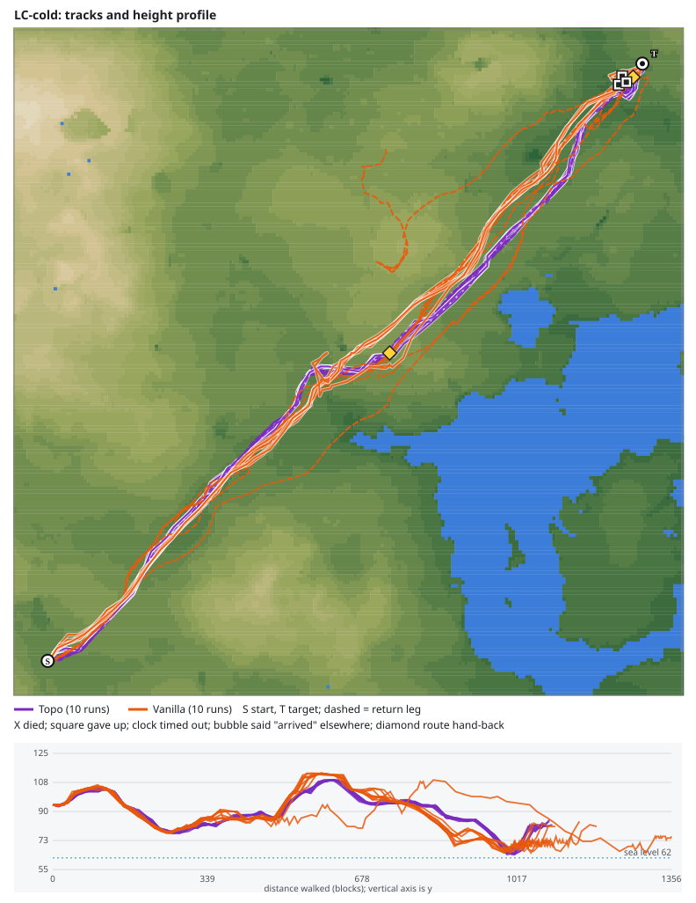
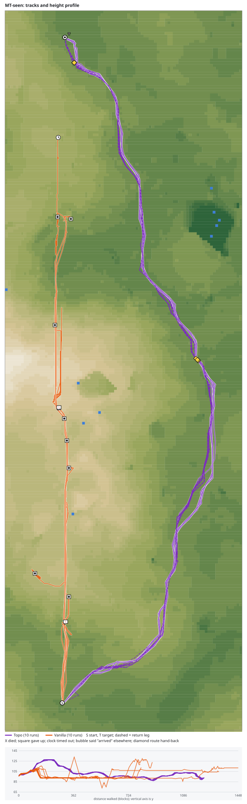
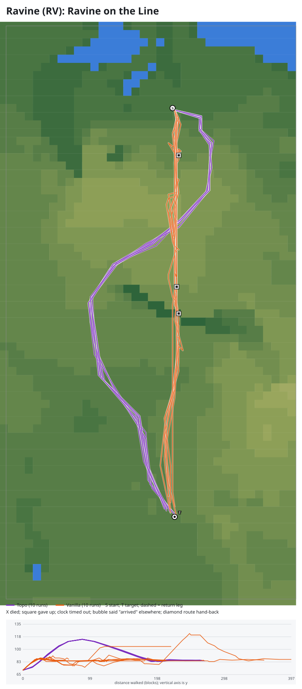

<div>
<h1 align="center">🗺️ Cartography for Mindcraft-CE</h1>

<p align="center">A terrain map for <a href="https://github.com/mindcraft-ce/mindcraft-ce">Mindcraft CE</a> bots, built from the chunks they load.</p>
<p align="center">Spatial awareness and long-range routing from what the bot has actually seen.</p>

<p align="center">
  <a href="#getting-started">Getting Started</a> |
  <a href="#results">Results</a> |
  <a href="#architecture">Architecture</a> |
  <a href="docs/REFERENCE.md">Reference</a> |
  <a href="https://github.com/milkucha/mindcraft-ce-topography">Mindcraft fork</a>
</p>
</div>

> [!Note]
> Proof of concept: tested on one world and one model so far.

# What it is

A small local sidecar service. The bot forwards the chunks it loads; the service turns them into a terrain
map the bot can query and route over. The bot knows where the water, high ground, cliffs, flat sites and
buildings are, and it plans long trips from memory of the terrain it has seen. It uses no server mod, no
world save and no vision.

<a id="getting-started"></a>
# Getting Started

## Requirements

- Python 3.10+ (standard library only)
- The Mindcraft fork with the topography hooks: [mindcraft-ce-topography](https://github.com/milkucha/mindcraft-ce-topography)
- Minecraft Java Edition. Tested on **1.20.1**; should work on 1.18 and later (untested).

> [!Warning]
> Blocks added after 1.20.1 may be misread as non-natural ground.

## Install and Run

1. Start the service:
   ```powershell
   python main.py --name my-world          # map stored in maps/my-world.db
   ```
2. In the Mindcraft profile (or `settings.js`):
   ```json
   { "topography_enabled": true, "topography_service_url": "http://127.0.0.1:8090" }
   ```
3. Join the server and play. The map fills in as the bot loads chunks.

Routing is on by default (`topography_routing: false` turns it off). The terrain layer is called
*topography* in settings and commands.

<a id="results"></a>
# Results

Six routes in one natural world (seed 6542604540806855638), 10 runs per route per agent. **Topo** is
Mindcraft with this service; **Vanilla** is plain Mindcraft CE. Both use the same model (DeepSeek flash),
given one instruction: go to these coordinates.

Topo in purple, Vanilla in orange (as in the charts). **Arrival rate** is the share of runs in which the bot reached the target (within 5 blocks). **Tokens per run**
is the average model usage per run, outbound and return legs together. **Tokens per successful trip** is the
average for the legs (outbound or return) that arrived.

| Route | Length (blocks) | Arrival rate (%): Topo | Arrival rate (%): Vanilla | Tokens per run: Topo | Tokens per run: Vanilla | Tokens per successful trip: Topo | Tokens per successful trip: Vanilla |
|---|---|---|---|---|---|---|---|
| Long, Control (LC): Dry Ground | 1000 | $\color{Purple}\textbf{100}$ | $\color{BurntOrange}\textsf{60}$ | $\color{Purple}\textbf{12k}$ | $\color{BurntOrange}\textsf{43k}$ | $\color{Purple}\textbf{6k}$ | $\color{BurntOrange}\textsf{18k}$ |
| Long, Water 1 (LW1): Lake on the Line | 1000 | $\color{Purple}\textbf{100}$ | $\color{BurntOrange}\textsf{0}$ | $\color{Purple}\textbf{13k}$ | $\color{BurntOrange}\textsf{169k}$ | $\color{Purple}\textbf{7k}$ | – |
| Long, Water 2 (LW2): 332-Block Bay | 1000 | $\color{Purple}\textbf{100}$ | $\color{BurntOrange}\textsf{80}$ | $\color{Purple}\textbf{20k}$ | $\color{BurntOrange}\textsf{85k}$ | $\color{Purple}\textbf{10k}$ | $\color{BurntOrange}\textsf{45k}$ |
| Mountain (MT): Massif, Unseen | 1000 | $\color{Purple}\textbf{100}$ | $\color{BurntOrange}\textsf{0}$ | $\color{Purple}\textbf{21k}$ | $\color{BurntOrange}\textsf{145k}$ | $\color{Purple}\textbf{10k}$ | – |
| Mountain, Seen (MT-seen): Massif, Seen First | 1000 | $\color{Purple}\textbf{100}$ | $\color{BurntOrange}\textsf{0}$ | $\color{Purple}\textbf{24k}$ | $\color{BurntOrange}\textsf{153k}$ | $\color{Purple}\textbf{12k}$ | – |
| Ravine (RV): Ravine on the Line | 200 | $\color{Purple}\textbf{100}$ | $\color{BurntOrange}\textsf{70}$ | $\color{Purple}\textbf{6k}$ | $\color{BurntOrange}\textsf{39k}$ | $\color{Purple}\textbf{6k}$ | $\color{BurntOrange}\textsf{26k}$ |
| **All** |  | $\color{Purple}\textbf{100}$ | $\color{BurntOrange}\textsf{35}$ | $\color{Purple}\textbf{16k}$ | $\color{BurntOrange}\textsf{106k}$ | $\color{Purple}\textbf{9k}$ | $\color{BurntOrange}\textsf{32k}$ |

Topo also walked the return leg on every run, so its per-run figures cover more walking. Vanilla's failed runs kept
the model busy (digging, crafting, retrying) until it gave up or timed out, which is why its token use is highest
where it never arrived. A dash means Vanilla never arrived on that route.

- **Return legs:** Topo 50/50, Vanilla 10/14.
- **Deaths:** Topo 0, Vanilla 2.
- **Ravine:** Topo stayed away from the edge in 10/10 runs; Vanilla walked to it in 9/10 (neither fell).

> [!Important]
> **Limits**
> - In unseen mountains, Topo goes over the top; it only routes round terrain it has seen.
> - Topo allows short swims (up to 2 water cells; 4–14 s in water on the lake and the bay).
> - On half the mountain legs, the model had to re-issue the command near the target.
> - The bay and ravine differences are not significant at 10 runs.

Each chart shows all 20 journeys on one route (Topo purple, Vanilla orange) over the terrain, with a
height profile below.

<table align="center"><tr><td width="720">
<a href="docs/results/LC-cold.svg"></a>
<hr>
<p><strong>Summary</strong></p>
<p>Both bots set off along the straight line, and on open ground they look much alike. Topo arrived every time, in about five minutes. Vanilla made it six times; in the other four, its pathfinder got stuck hopping in place about 30 blocks from the target, and it never got going again.</p>
</td></tr></table>

<table align="center"><tr><td width="720">
<a href="docs/results/LW1-cold.svg"></a>
<hr>
<p><strong>Summary</strong></p>
<p>A lake lies across the straight line. Topo went round it every time, crossing only one short channel (8 to 14 seconds in water). Vanilla headed straight for the water, then dug, crafted and wandered, mostly on the near side; it gave up or ran out of time on all ten runs, once just 24 blocks short.</p>
</td></tr></table>

<table align="center"><tr><td width="720">
<a href="docs/results/LW2-cold.svg"></a>
<hr>
<p><strong>Summary</strong></p>
<p>A 332-block bay sits on the line. Topo took the long way round the west shore, with only a few seconds in water. Vanilla swam straight across, spending up to four and a half minutes in the water; it arrived eight times and gave up twice.</p>
</td></tr></table>

<table align="center"><tr><td width="720">
<a href="docs/results/MT-cold.svg"></a>
<hr>
<p><strong>Summary</strong></p>
<p>A mountain massif blocks the line, and Topo had never seen the area, so it had no valley to plan through and went up and over the top (climbing about 155 blocks). It still arrived every time, and on the way back, with the area now seen, it took the lower road to the east. Vanilla walked into the massif, got stuck in its slopes and caves, and never arrived; it died once.</p>
</td></tr></table>

<table align="center"><tr><td width="720">
<a href="docs/results/MT-seen.svg"></a>
<hr>
<p><strong>Summary</strong></p>
<p>The same massif, but Topo had walked the area before. This time it planned the low road round the east side from the start, climbing only 73 to 80 blocks. Vanilla, with no map, went straight into the mountain again and gave up or timed out on all ten runs.</p>
</td></tr></table>

<table align="center"><tr><td width="720">
<a href="docs/results/RV-cold.svg"></a>
<hr>
<p><strong>Summary</strong></p>
<p>A deep ravine cuts across a 200-block trip. Topo routed round it without ever going near the edge. Vanilla walked straight to the edge nine times out of ten; it never fell, but it arrived only seven times.</p>
</td></tr></table>

# How it works

1. **Feed:** the bot sends each chunk it loads (`POST /chunk_raw`) and its seen/unloaded chunks (`POST /seen`).
2. **Map:** the service reduces each chunk to a per-column surface record and stores it.
3. **Perception:** every prompt, the bot gets a short terrain summary of its surroundings (`GET /perception`,
   at most 1200 characters).
4. **Queries:** the model can ask for more: flat build sites, shoreline, landforms, the far overview, a
   remembered chunk.
5. **Routing:** a go-to command for a far target asks `GET /route` for waypoints over seen terrain, and
   Mindcraft's own pathfinder walks them leg by leg.

<a id="architecture"></a>
# Architecture

```
Mindcraft bot ── POST /chunk_raw, /seen, /position ──▶ cartography service ──▶ SQLite (one DB per world)
      ▲                                                  │
      └──── GET /perception, queries, /route ◀───────────┘
   (optional) world save / Fabric plugin ──▶ same ingest path
```

## Ingest

`POST /chunk_raw` carries a chunk's block palettes and packed indices, gzip-compressed, at
most 16 chunks per request. `bot_chunk.py` rebuilds the same Anvil-shaped structure a save would give. It
then runs the same decoder as the save reader (`loader.py`), so a bot-fed chunk and a save-read chunk
produce identical records (tested). Decoding runs in worker processes so feeding new terrain doesn't
slow queries. A save or the optional Fabric plugin feed the same path. Only the Overworld is stored.

## Column model

Each column keeps three heights:
- `y`: the topmost non-air block.
- `ground_y`: the topmost solid block.
- `terrain_y`: the topmost *natural* ground, found by scanning down past roofs, decks, trees and water.

`terrain_y` is what lets the map tell a hill from a house, and a lake from a bridge. The list of natural
blocks lives in `terrain_rules.py`. Composition (water, trees, built blocks, ores at the surface) is stored
per chunk.

## Store

`map_store.py` is tiered:
- **hot:** the bot's current perception window.
- **warm:** an LRU of recently queried chunks.
- **cold:** SQLite.

Writes are batched and flushed about every 2 s. Every change bumps a store generation that clients cache
on. An unchanged re-send changes nothing.

## What the bot knows

Every query takes `agent=`, and chunks that agent hasn't seen are reported as
unexplored, never filled in. A chunk the bot has left is shown as it was when last loaded. It stays that way
even if the world changes, via per-chunk revisions and copy-on-write history, until the bot sees it again.
This is the map of a player, not of the server.

## Overview

Each chunk revision also writes a tiny summary row: water, ground height range, trees, built
columns, land class. `GET /overview` reads only these summaries to describe everything seen within up to
4096 blocks (water bodies, high ground, built areas by direction) at a flat cost, however much has been
seen.

## Routing

`route.py` runs A* on a 4-block grid over the agent's seen chunks.
- **Cost:** climbing costs 2 per block of ascent, and paths and bridges are cheaper. Cliffs are impassable, and at most 2 consecutive water
  cells may be crossed.
- **Search area:** the straight-line box padded by a quarter of the trip length (96–384 blocks), widened
  once if the search hits its edge.
- **Time bound:** each search stops at 1.5 s. The answer is complete, or partial with a reason
  (`unexplored`, `water`, `terrain`, `limit`).
- **Walking:** the Mindcraft side walks each leg with the stock pathfinder and replans as it goes. It
  follows shorelines when water blocks the way, resumes after Mindcraft's own unstuck mode, and hands back
  to the model when it can't continue.

## HTTP

`api.py` is a standard-library `ThreadingHTTPServer`. It binds to loopback by default; off
loopback, a bearer token (`--token`) is mandatory. The full interface is in [docs/CONTRACT.md](docs/CONTRACT.md); options, endpoints and internals are in [docs/REFERENCE.md](docs/REFERENCE.md).

# Tests

```powershell
python -m unittest discover -s tests
```

Builds a synthetic world, so no Minecraft is needed.

# License

MIT (see [LICENSE](LICENSE)).
